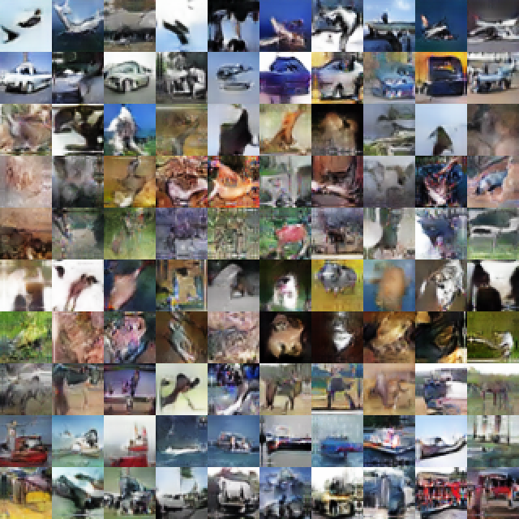

# CIFAR-10 Image Generation with GANs and a VAE

> **Team project, led by [Eaint Chu Nay Chi (Chu)](https://github.com/Chu268) (about 70% of the work).**
> **My role (Phyu Sin Lynn, about 30%):** discussing model and experiment choices, reviewing the implementation and results, suggesting improvements and evaluation methods, and checking the final conclusions and notebook.

Generating new 32×32 colour images of the 10 CIFAR-10 classes. Three generative models were compared, and then a **conditional DCGAN** was improved step by step, since it can generate a *requested* class.

<p align="center">
  
</p>
<p align="center"><sub>Final model output: one row per class (airplane, automobile, bird, cat, deer, dog, frog, horse, ship, truck)</sub></p>

## Results

**Baselines** (FID: lower is better)

| Model | FID | Note |
|---|---|---|
| DCGAN | 47.71 | Best baseline FID, but cannot choose the class |
| **Conditional DCGAN** | 55.14 | Class-controlled, so this was chosen for improvement |
| VAE | 204.48 | Stable training, but blurry images |

**Improving the conditional DCGAN**

| Experiment | Change | Validation FID |
|---|---|---|
| Baseline | — | 55.14 |
| 1 | Larger latent dimension (128) | 79.92 |
| 2 | Improved generator + one-sided label smoothing (0.8) | 48.77 |
| 3 | Experiment 2 + slower discriminator learning rate | 52.11 |
| 4 | Experiment 2 + data augmentation | 46.98 |
| **5** | **Experiment 4 trained for 100 epochs** | **39.05** |

- **Final model (Experiment 5): test FID 33.69** on the 10,000 unseen CIFAR-10 test images.
- **Manual check of generated images:** 63.5% clearly recognisable and 9.5% unrecognisable, up from 54.5% and 14.0% before the longer training.
- **Easiest classes:** ship, airplane, automobile and horse (distinctive shapes and backgrounds). **Hardest:** cat, dog and frog (more varied poses and textures).
- **1,000 final images** (100 per class) are in `final_1000_generated_images/`.

## Approach

1. **Data checks and EDA**: pixel ranges, class balance, duplicates and sample images; stratified train / validation split.
2. **Baselines**: DCGAN, conditional DCGAN and VAE, compared with **FID** (Fréchet Inception Distance, using InceptionV3 features).
3. **Controlled experiments**: one change at a time to the conditional DCGAN, judged by FID and a manual clear / marginal / nonsense rating.
4. **Final evaluation**: FID on the held-out test set, a check for overfitting and mode collapse, and per-class difficulty analysis.

## Files

| Path | Description |
|---|---|
| `cifar10_gan_vae_image_generation.ipynb` | Full workflow with outputs |
| `exp5_generator.weights.h5`, `exp5_discriminator.weights.h5` | Final model weights |
| `final_1000_generated_images/` | 1,000 generated images, sorted by class |
| `generated_samples_grid.png` | Preview grid |

## Tools

Python · TensorFlow / Keras · InceptionV3 (FID) · SciPy · NumPy · pandas · scikit-learn · Matplotlib

## Run it

```bash
pip install -r requirements.txt
jupyter notebook cifar10_gan_vae_image_generation.ipynb
```

## Team

**Eaint Chu Nay Chi (Chu)**, project lead — [GitHub](https://github.com/Chu268)
**Phyu Sin Lynn (Emi)**, supporting member — [Portfolio](https://emi-psl.github.io/portfolio/) · [GitHub](https://github.com/emi-psl) · [LinkedIn](https://www.linkedin.com/in/phyusinlynn)

*Completed as pair coursework for the Deep Learning module at Singapore Polytechnic.*
